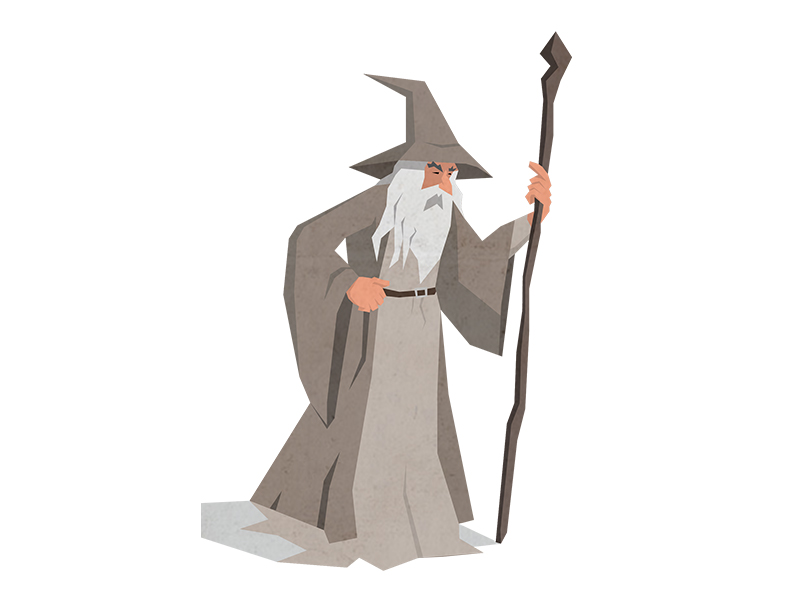

<h3 align="center">Hi, Hola, Bonjour, Namaste — welcome to my corner of GitHub</h3>

  

  
  
  
  

  

## I'm Deepak Sharma 👋

> *"I like to make user interfaces beautiful — but I love back-end."*  
> Building apps that look premium and scale like real products.

- 🔭 **Software Engineer @ Deloitte India** — shipping production **mobile & digital** experiences
- 🌱 Deep-diving **Flutter architecture**, **Jetpack Compose**, **Firebase/backends**, **Next.js/TS**, and **AI dev workflows** (Cursor, agents, MCP)
- 💻 **Toolbox:**
  
  
  
  
- 👯 Open to **Flutter/Android collabs**, **open source**, and **AI × mobile** experiments
- 💬 Ask me about **architecture**, **store/CI pipelines**, **Material Design**, or **shipping faster**
- 😄 Call me **Deep** · ⚡ When I'm not coding, I'm probably tuning automations (or sleeping)

---

### ⚡ At a glance

| 🎯 Focus | 📦 Open source | 🌍 Community | 🧠 Right now |
|:---:|:---:|:---:|:---:|
| Flutter & Android products | **40+** public repos | **50+** GitHub followers | AI agents & MCP tooling |
| Firebase & clean architecture | **[KotlinProject](https://github.com/webaddicted/KotlinProject)** · **86⭐** | Stack Overflow contributor | E‑commerce & portfolio apps |
| Enterprise @ Deloitte | Android samples & libraries since **2018** | Open to **hire** & collab | Jetpack Compose + Cursor skills |

---

### 🛠️ Tech arsenal

  

---

## 📫 How to reach me

  
  
  

  
  &nbsp;
  
  &nbsp;
  

---

### 📈 GitHub analytics

  
  

  

### 🐍 Contribution snake

  

<i>Snake updates daily via GitHub Actions — run <b>Generate contribution snake</b> workflow once if this is your first visit after the upgrade.</i>

---

### 🏆 Featured open source

| Project | What it is | Stars |
|---------|------------|:-----:|
| [**KotlinProject**](https://github.com/webaddicted/KotlinProject) | Android kitchen sink — Material, Firebase, Room, dark theme, PIP | **86⭐** |
| [**E-Commerce-Disinfectant**](https://github.com/webaddicted/E-Commerce-Disinfectant) | Flutter e‑commerce UX — auth, OTP, farmer-focused flows | **11⭐** |
| [**CleanArchitecture**](https://github.com/webaddicted/CleanArchitecture) | Kotlin MVVM reference with Koin & LiveData | **10⭐** |
| [**ImagePickerCompressor**](https://github.com/webaddicted/ImagePickerCompressor) | Camera/gallery + compression for modern Android | **9⭐** |

### 🚀 Spotlight projects

  
  

---

